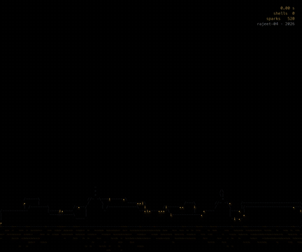
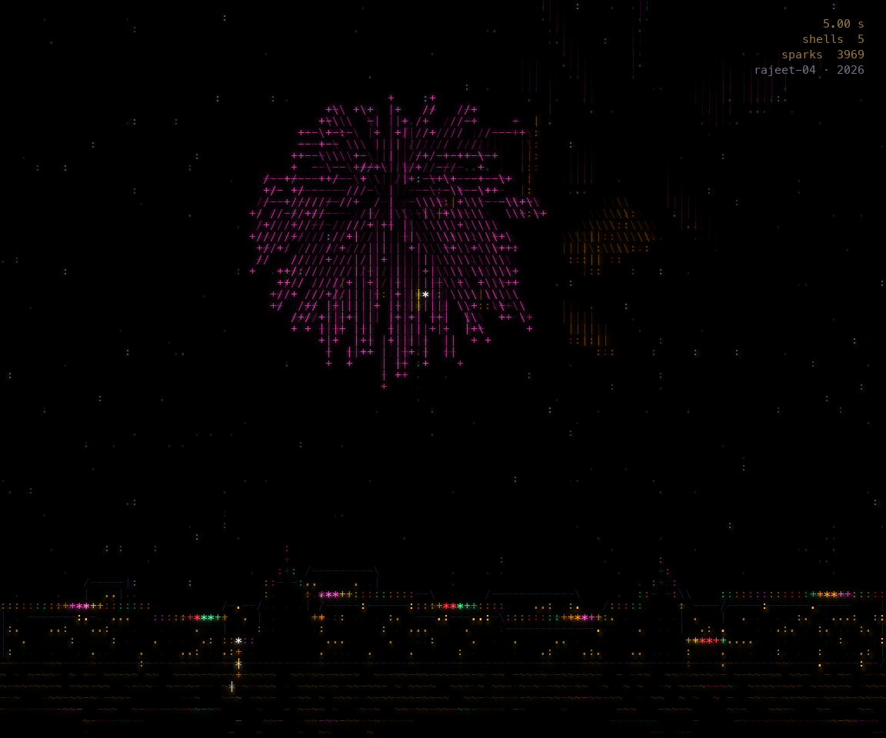
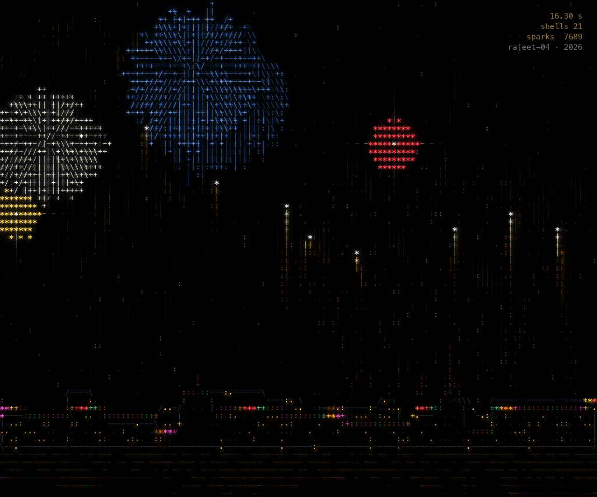
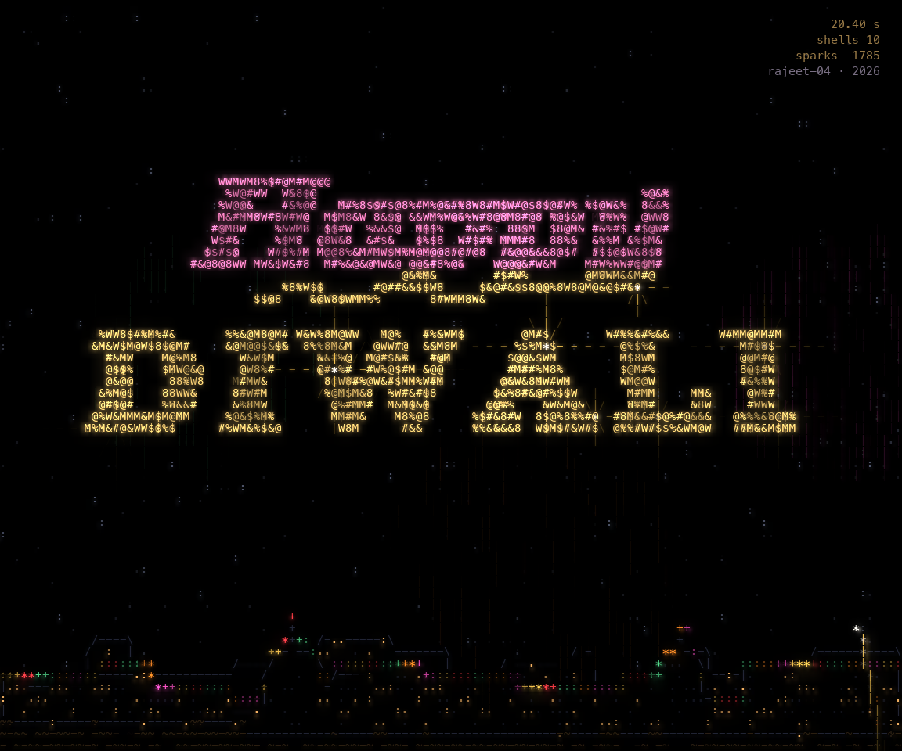

# Happy Diwali

An animated ASCII artwork by [rajeet-04](https://github.com/rajeet-04), 2026.



Shells climb into a black sky over a city on the water, open into peonies, rings,
willows and palms, build to a finale, and the last one writes a greeting across
the sky before it falls as embers. Every pixel is a letter or symbol.

| Sky shots | Finale | Greeting |
|---|---|---|
|  |  |  |

## Run

```sh
uv run --with-requirements requirements.txt diwali.py
```

Space pause · R replay · S save a still · Esc quit. Without uv:
`pip install -r requirements.txt && python diwali.py`.

## How it is made

- **Flight:** rockets follow ballistic arcs; burst stars follow the exact solution
  of motion under linear drag and gravity, `dv/dt = -k v - g ŷ`.
- **Shells:** golden-angle sphere sampling (peony, chrysanthemum), tilted rings with
  a contrasting core, high-drag willows that crackle, and palms with thick arms.
- **Greeting:** a text mask becomes 3D points; stars fly to them on quadratic Bézier
  paths that overshoot and settle, writing left to right.
- **Scene:** a low camera by the water in perspective, a skyline with temple domes,
  chasing rooftop lights and rippling reflections.
- **Letters:** a z-buffer picks the nearest point per cell; boundaries become strokes
  chosen by gradient angle, moving sparks become strokes along their motion, and a
  fading afterimage and two-width bloom make the light glow.

Details in [HOW_IT_WORKS.txt](HOW_IT_WORKS.txt).

## License

Free for personal, non-commercial use; credit rajeet-04 when you share. See [LICENSE.txt](LICENSE.txt).
