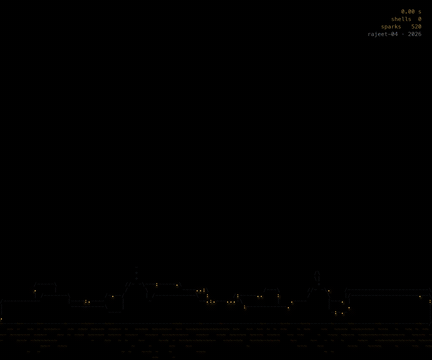

# ascii-math-art

ASCII art made from mathematics, by [rajeet-04](https://github.com/rajeet-04).



## What's here

| | |
|---|---|
| [DIWALI/](DIWALI/) | **Happy Diwali**: a hand-written procedural ASCII animation in one Python file. Fireworks over a city on the water, ballistic shells, drag-and-gravity bursts, and a greeting written by the stars of the last shell. |
| [engine/](engine/) | **Math-equation ASCII engine** (Rust): turns any video, GIF or image into one standalone Rust program whose picture is generated only by fitted equations (sine coordinate networks, numeric coefficients, no stored frames), played back as artistic ASCII in the terminal. Also converts video to ASCII/pixel-art MP4, GIF and PNG. |
| [docs/](docs/), [HANDOFF.md](HANDOFF.md) | Design specs, plans and measured results for the engine. |
| `giphy.gif`, `giphy (1).gif` | The two test clips used for the measurements in HANDOFF.md. |

## Quick start

```sh
# The Diwali artwork
cd DIWALI && uv run --with-requirements requirements.txt diwali.py

# The engine (needs Rust and FFmpeg; fitting also needs MLX on Apple silicon)
cargo build --release --manifest-path engine/Cargo.toml
export ASCII_ART_PYTHON=/path/to/python-with-mlx-and-numpy
engine/target/release/ascii-math-art clip.gif clip.rs --format equations \
  --columns 256 --rows 256 --scale 1 --fps 20
rustc --edition 2024 -O clip.rs -o clip && ./clip --terminal
```

Video or image in, equations out: each input gets its own fitted coefficients
(about 800 KB of plain numbers), and the generated player evaluates them at your
terminal's resolution, so zooming the terminal out gives finer characters.
See [engine/README.md](engine/README.md).

## License

Free for personal, non-commercial use; credit rajeet-04 when you share.
See [LICENSE](LICENSE).
